<p align="center">
  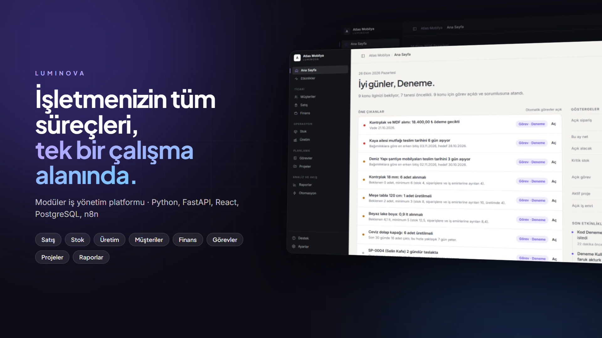
</p>

# LUMINOVA

**LUMINOVA**, küçük ve orta ölçekli işletmeler için geliştirilmiş, çok kiracılı (multi-tenant) ve modüler bir iş yönetim platformudur. Satış, stok, üretim, müşteri, finans, görev ve proje yönetimini tek bir çalışma alanında toplar. Her şirket yalnızca ihtiyaç duyduğu modülleri açar; yönetici, ekibindeki her kişinin hangi modülü görüp hangisinde değişiklik yapabileceğini kendisi belirler.

Proje, **Ömer Faruk Aktürk** tarafından uçtan uca tasarlanıp geliştirilmiştir: veri modeli, iş kuralları, API, arayüz, e-posta otomasyonu ve yayın yapılandırması.

> Bu depo, LUMINOVA'nın uygulama kodunu (backend, frontend, veritabanı migration'ları ve testler) inceleme amacıyla içerir. Sunucu ve yayın yapılandırması, ortam dosyaları ve yardımcı betikler özel tutulmaktadır. Kod açık kaynak değildir; ayrıntılar için [Lisans](#lisans) bölümüne bakın.

**▶ Uygulama turu (59 sn):** [assets/luminova-uygulama-turu.mp4](assets/luminova-uygulama-turu.mp4) — bir yöneticinin kayıt olup tüm modülleri açması, modülleri gezmesi ve ekibine yeni bir üyeyi onaylaması.

---

## Ne işe yarar?

Küçük işletmelerde teklif bir Excel dosyasında, stok başka bir tabloda, tahsilatlar bir defterde, yapılacak işler ise mesajlaşma gruplarında takip edilir. LUMINOVA bu parçaları birbirine bağlar: onaylanan bir sipariş gelir kaydını ve görevleri kendiliğinden oluşturur, teslim edildiğinde stoktan düşer, eksik malzeme varsa üretim emri açar, kritik seviyeye inen ürün için yöneticiye haber verir.

## Modüller

| Modül | Öne çıkanlar |
|---|---|
| **Müşteriler ve Teklifler** | Müşteri kartında teklif, sipariş, tahsilat ve proje geçmişi; mükerrer kayıt uyarısı; CSV/Excel içe aktarma; teklifin müşteriye e-postayla gönderilmesi ve müşterinin bağlantıdan kabul veya ret vermesi |
| **Satış ve Siparişler** | Onayda gelir kaydı ve görev şablonu, teslimde stok düşümü, iptalde ters hareket; satır ve genel iskonto |
| **Stok ve Depo** | İki seviyeli uyarı (minimum ve kritik), rezerve ve kullanılabilir miktar, tüketim hızına göre sipariş önerisi |
| **Üretim** | Reçeteler, reçeteden otomatik malzeme hesabı, eksik stokta siparişe bağlı iş emri |
| **Finansal Takip** | Kısmi tahsilat ve ödemeler, vadeler, müşteri bakiyeleri, haftalık nakit akışı ve tahmini kasa |
| **Görevler** | "Bugün" görünümü, görev bağımlılıkları, şablonlar ve sistemin riskli durumlar için kendiliğinden açtığı görevler |
| **Projeler** | Aşamalar, iş günü takvimi, kritik yol, beklenen ve gerçekleşen ilerleme, gecikme riski |
| **Raporlar** | Satış, stok, üretim ve finans göstergeleri |
| **Otomasyon** | Olayların imzalı webhook'larla n8n gibi dış sistemlere aktarılması, dışarıdan görev alma |

## Ekip, roller ve gizlilik

- **İki tür kayıt:** Yönetici şirketini kurar. Çalışan ise yöneticinin verdiği katılım koduyla (ör. `ABCD-1234`) kayıt olur; kod girildiği anda hangi şirkete katılacağı görünür.
- **Onaylı katılım:** Yeni üye, yönetici onaylayana kadar giriş yapamaz. Yönetici onay sırasında modül bazında **görüntüleme** veya **düzenleme** yetkisini seçer. Seçilmeyen modüller üyenin menüsünde hiç görünmez; ana sayfa, raporlar ve etkinlik akışı da buna göre süzülür.
- **6 haneli e-posta doğrulama kodu:** 30 dakika geçerlidir; hatalı deneme ve yeniden gönderme sınırlıdır.
- **Platform yönetim paneli:** Platform ekibi şirketleri, kullandıkları modülleri ve ekiplerini görür, şirketlere mesaj gönderir ve gerektiğinde şirketi tüm verisiyle siler. Şirketlerin finans, müşteri ve stok kayıtları bu panelde **gösterilmez**.
- **Destek:** Yöneticiler profillerindeki "Bize ulaşın" bölümünden sorun, şikâyet ve öneri iletir; platform ekibinin yanıtları bildirim olarak düşer.

## E-posta otomasyonu (n8n)

Uygulama e-postaları doğrudan göndermez. Mesajlar önce veritabanındaki bir kuyruğa yazılır, ardından arka plan işçisi HMAC ile imzalayarak n8n'e iletir; n8n imzayı doğrular ve SMTP üzerinden gönderir. Başarısız gönderimler yeniden denenir, gönderildikten sonra e-posta gövdesi silinir.

Gönderilen e-postalar: kayıt doğrulama kodu, şifre sıfırlama, ekip daveti, katılım onayı, müşteriye teklif, teklif kabul/ret bildirimi, kritik stok uyarısı ve her pazartesi 09:00'da şirket saatine göre haftalık durum özeti.

## Mimari

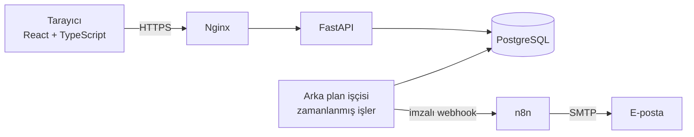

- **Modüler monolit:** Her modül kendi servis, şema ve uç noktalarına sahiptir; tek bir uygulama olarak dağıtılır.
- **Satır düzeyinde kiracı ayrımı:** Şirkete ait her tabloda `company_id` bulunur; her sorgu oturumdaki şirkete göre süzülür.
- **Tutarlılık:** Stok düşümü ve üretim tamamlama gibi işlemler aynı transaction içinde, satırlar kilitlenerek yapılır; aynı işlem iki kez stok düşürmez.
- **Güvenlik:** Çerez tabanlı oturum ve CSRF koruması, giriş ve şifre sıfırlama hız sınırları, rol ve modül yetkisi kontrolü, güvenlik başlıkları, denetim kayıtları (audit log).
- **Zamanlanmış işler:** Hatırlatmalar, otomatik görevler ve haftalık özet her 5 dakikada bir çalışan işçi tarafından üretilir.

## Teknolojiler

| Katman | Kullanılanlar |
|---|---|
| Arka uç | Python, FastAPI, SQLAlchemy 2, Alembic, Pydantic v2 |
| Veritabanı | PostgreSQL 16 |
| Ön yüz | React 19, TypeScript, Vite, Tailwind CSS, React Router |
| Otomasyon | n8n (imzalı webhook ile e-posta) |
| Test | pytest — 130'dan fazla otomatik backend testi |
| Yayın | Docker, Docker Compose, Nginx |

## Ekran görüntüleri

| | |
|---|---|
| 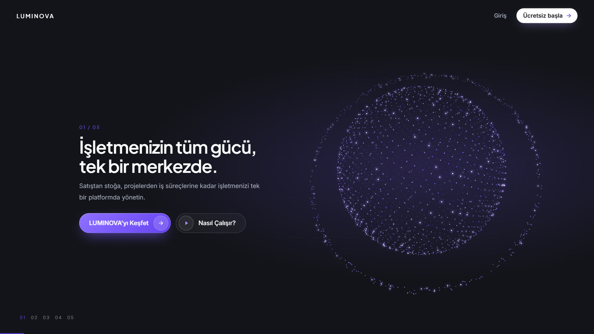 | 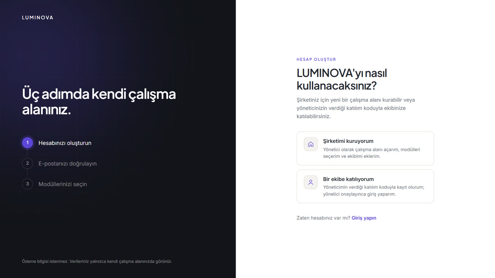 |
| **Karşılama sayfası** | **Kayıt: yönetici veya ekip üyesi** |
| 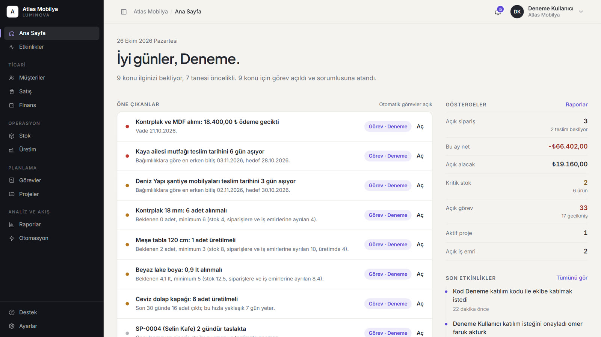 | 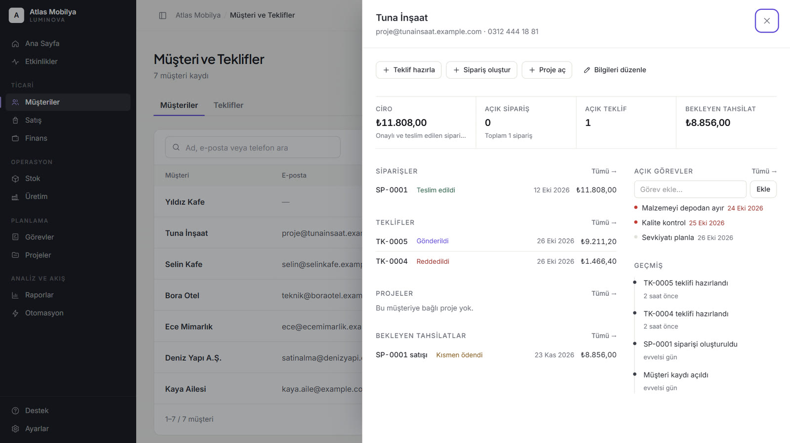 |
| **Ana sayfa: öne çıkanlar ve göstergeler** | **Müşteri kartı** |
| 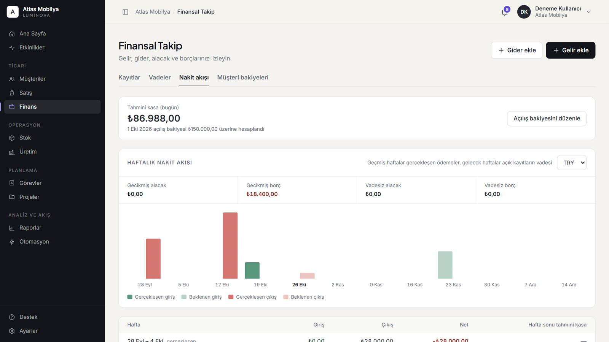 | 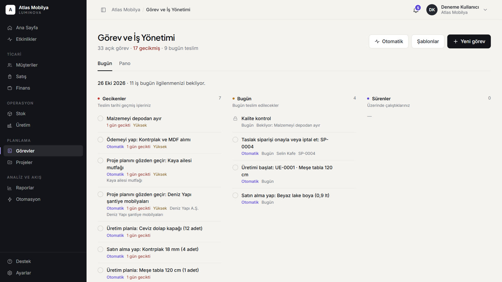 |
| **Nakit akışı ve tahmini kasa** | **Görevler: Bugün görünümü** |
| 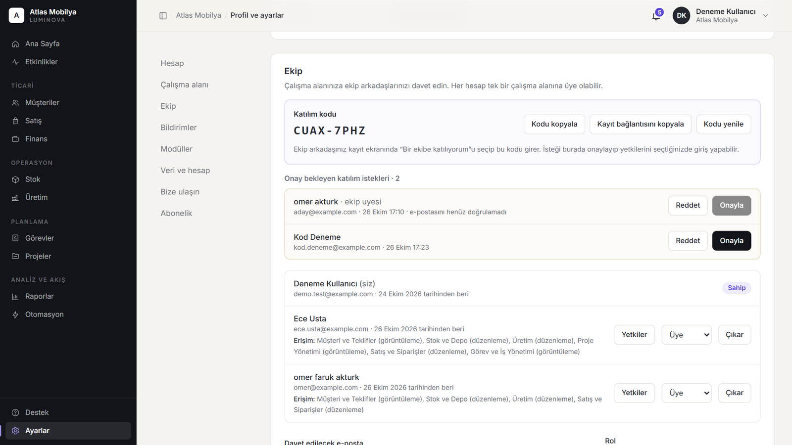 | 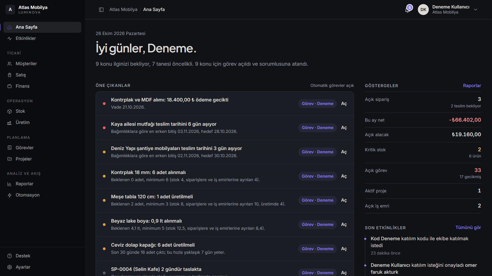 |
| **Katılım kodu, onay istekleri ve yetkiler** | **Koyu tema** |
| 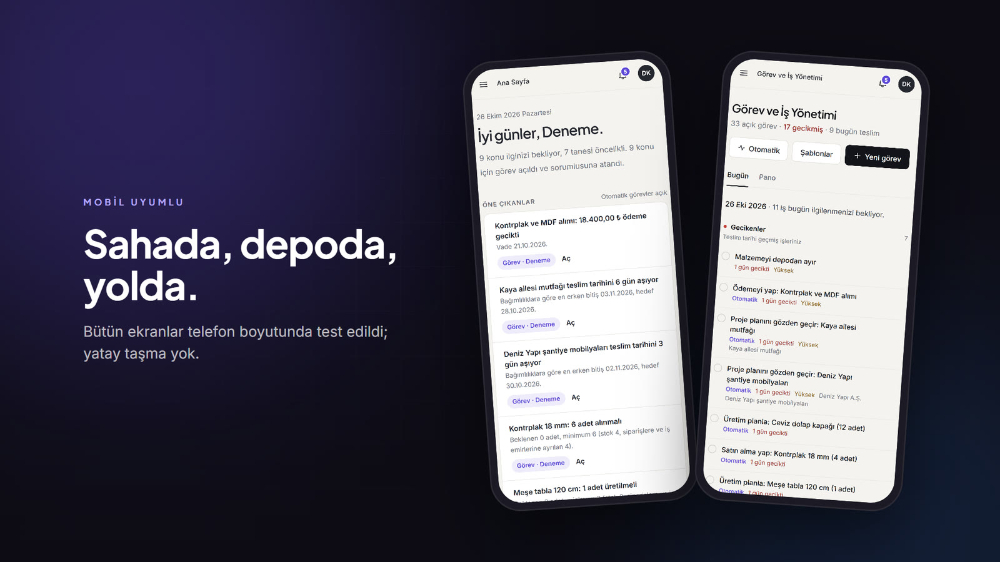 | 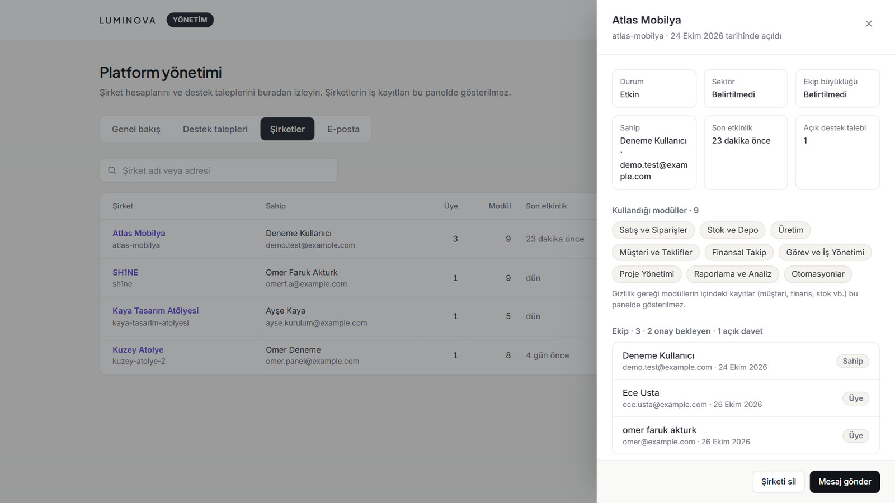 |
| **Mobil görünüm** | **Platform yönetim paneli** |

Ekran görüntülerindeki şirket, kişi ve tutarlar demo verisidir.

## Kod yapısı

```
backend/
  app/
    api/          uç noktalar ve ortak bağımlılıklar (oturum, CSRF, modül yetkisi)
    models/       SQLAlchemy modelleri
    schemas/      Pydantic istek/yanıt şemaları
    modules/      iş modülleri: customers, quotes, sales, inventory, production,
                  finance, tasks, projects, reporting, automation
    services/     kimlik, ekip, bildirim, e-posta kuyruğu, içgörüler, zamanlayıcı, yönetim
  alembic/        veritabanı migration'ları
  tests/          pytest testleri
frontend/
  src/
    pages/        kayıt, giriş, kurulum, çalışma alanı ve yönetim sayfaları
    components/   modül ekranları, formlar, paneller
    lib/          API istemcisi ve tipler
docs/
  mimari.md       veri modeli, iş kuralları ve kararlar
  n8n.md          e-posta ve webhook sözleşmesi
```

İncelemeye başlamak için:

| Konu | Dosya |
|---|---|
| Modül yetkisi (her uç noktada tek satır) | [`backend/app/api/deps.py`](backend/app/api/deps.py) |
| Kayıt, e-posta kodu, giriş ve katılım kodu | [`backend/app/services/auth.py`](backend/app/services/auth.py) |
| Katılım onayı ve üye yetkileri | [`backend/app/services/team.py`](backend/app/services/team.py) |
| Sipariş onay/teslim kuralları | [`backend/app/modules/sales/rules.py`](backend/app/modules/sales/rules.py) |
| Reçete ve malzeme hesabı | [`backend/app/modules/production/recipes.py`](backend/app/modules/production/recipes.py) |
| Proje planı, kritik yol ve riskler | [`backend/app/modules/projects/planning.py`](backend/app/modules/projects/planning.py) |
| Görev bağımlılıkları ve şablonlar | [`backend/app/modules/tasks/workflow.py`](backend/app/modules/tasks/workflow.py) |
| Nakit akışı ve bakiyeler | [`backend/app/modules/finance/reports.py`](backend/app/modules/finance/reports.py) |
| Otomatik görevler ve öne çıkanlar | [`backend/app/services/insights.py`](backend/app/services/insights.py) |
| İmzalı e-posta kuyruğu (n8n) | [`backend/app/services/mail.py`](backend/app/services/mail.py) |
| Şirket silme ve platform paneli | [`backend/app/services/admin.py`](backend/app/services/admin.py) |

## Durum

Uygulama yerel ortamda uçtan uca çalışmaktadır. Ödeme altyapısı bilinçli olarak bağlanmamıştır; tüm çalışma alanları ücretsiz erken erişim modundadır.

## Lisans

© 2026 Ömer Faruk Aktürk. Tüm hakları saklıdır. Kod yalnızca incelenmek üzere paylaşılmıştır; izin alınmadan kopyalanamaz, değiştirilemez, dağıtılamaz veya ticari amaçla kullanılamaz.
